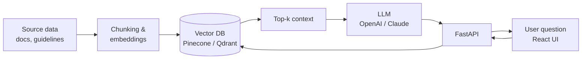

<h1 align="center">Hi, I'm Andrii 👋</h1>

  <b>Senior Full-Stack &amp; AI Engineer</b> 
  Python backends, LLM features and React interfaces for HealthTech, e-commerce and B2B SaaS.

  
  
  

---

### 🧭 About

6+ years building web, mobile and AI-powered products for European clients. I started with **React Native**, moved into full-stack **TypeScript**, and since 2023 I focus on **Python backends and LLM features**: RAG pipelines, vector search, LLM-based reporting, async processing and the React interfaces on top of them.

I like owning a feature from architecture and API design to production deployment, and talking to product managers directly while doing it.

> 🔎 **Currently looking for:** Senior Full-Stack or AI Engineer roles, remote EU/US.

---

### 🛠️ Toolbox

<table>
  <tr>
    <td width="130"><b>🤖 AI</b></td>
    <td>
      
      
      
      
      
      
      
    </td>
  </tr>
  <tr>
    <td><b>⚙️ Backend</b></td>
    <td>
      
      
      
      
      
      
      
      
    </td>
  </tr>
  <tr>
    <td><b>🎨 Frontend</b></td>
    <td>
      
      
      
    </td>
  </tr>
  <tr>
    <td><b>☁️ Cloud &amp; quality</b></td>
    <td>
      
      
      
      
      
      
    </td>
  </tr>
</table>

---

### 🚀 Selected work

Most of this work was done for clients, so the code is private. Here's what I built and how.

<b>🏥 Lifeness</b> · HealthTech, Norway

 

AI features for care teams, built on top of health data and clinical guidelines.

- RAG pipelines with **LlamaIndex** and **LangChain** over health data and clinical guidelines
- Vector search with **Pinecone** and **Qdrant**, query times kept under 150 ms
- AI summarization for care teams

`Python` `FastAPI` `RAG` `Qdrant` `Pinecone` `React`

<b>🏨 Runwell</b> · Hospitality SaaS, Norway

 

LLM-powered reporting for operations teams.

- Python backend services with async processing (**Celery**, **RabbitMQ**)
- Reporting and summarization with **OpenAI** and **Claude** APIs, saving operations teams 15+ hours a week
- API latency kept under 200 ms with **Redis** caching

`Python` `Django` `Celery` `RabbitMQ` `Redis` `OpenAI` `Claude`

<b>📦 FairyLoot</b> · Subscription e-commerce, UK

 

Storefront, backend and billing for a platform with sharp traffic spikes during limited-edition drops.

- SSR/SSG storefront in **Next.js**, handling 50,000+ daily active users during product drops
- Core Web Vitals work: PageSpeed score up by 25+ points, LCP under 1.8 s
- **Stripe** and **PayPal** recurring billing with webhook-driven subscription lifecycle
- Query refactoring and index tuning on **PostgreSQL** (Prisma), about 30% lower query latency

`Next.js` `TypeScript` `NestJS` `Prisma` `Stripe` `PayPal`

<b>🤝 Pomagator</b> · Community help &amp; volunteering app

 

My first production mobile project, built in an Agile/Scrum team.

- Reusable **React Native** components following the design system
- Offline-first data handling with local persistence and sync on reconnection
- Firebase push notifications, deep linking and analytics
- Releases on Google Play and the App Store

`React Native` `Firebase` `Node.js` `Express`

---

### 🧩 How I usually build RAG features

---

### 📍 Career path

| Period | Role | Company | Focus |
|:--|:--|:--|:--|
| 2023 – 2026 | Senior Full-Stack Developer | **EL Passion** (now Monterail) | Python backends, RAG, LLM reporting, React |
| 2021 – 2023 | Middle Full-Stack Developer | **Syde GmbH** | Next.js storefronts, billing, performance |
| 2020 – 2021 | Junior Full-Stack Developer | **Dev and Deliver** | React Native, Node.js |

---

### 📫 Let's talk

If you're hiring for a Senior Full-Stack or AI Engineer role, or have an LLM feature that needs to get to production, I'd be glad to hear about it.

  <a href="https://www.linkedin.com/in/andrii-bielov-dev/">LinkedIn</a> ·
  <a href="mailto:YOUR_EMAIL@example.com">Email</a>

